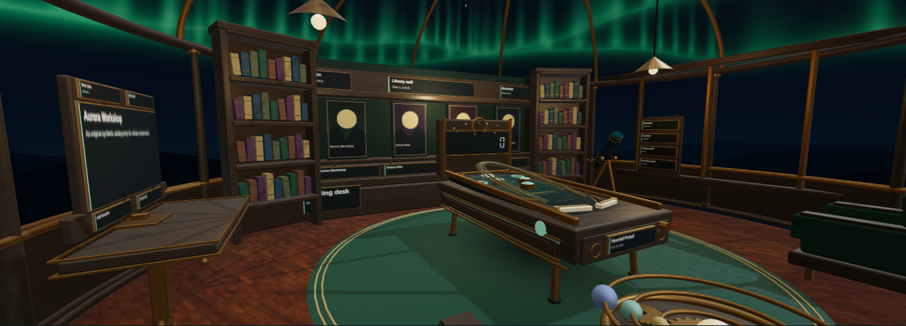

# Aurora Observatory realism preview

> **Doc status:** Reference

These seven images come from the actual Three.js room at source `1dc551520b1f0484d68f158d9a0b5d5bb84c0cc9`. The disposable fixture used synthetic game titles and cover art. The [CI run](https://github.com/cephyrixzyth/Oneirodex/actions/runs/45211222499) captured the overview, shelf aisle, reading desk, lounge, and Moonfall at Standard and Low quality. It also captured the in-world Help display.

[Shelf aisle](observatory-library.png) · [Reading desk](observatory-reading.png) · [Lounge](observatory-lounge-canvas.png) · [Standard table](moonfall-detail-canvas.png) · [Low-quality table](moonfall-low-canvas.png) · [In-world help](moonfall-in-world-help-canvas.png)

The [receipt](receipt.json) records the source, artifact digest, and each published image hash. The preview selected a case through the canvas, received the local art assets, and observed the Low-quality texture uploads without a WebGL error. Progress initialization required one retry in software Chromium. The measured frame intervals were about 2.5 seconds. Desktop and headset performance, close-up prop finish, and human visual acceptance remain open.

The later [gameplay qualification](https://github.com/cephyrixzyth/Oneirodex/actions/runs/45220750752) passed at `32212680`. The [normally played result](moonfall-played-result.png) shows the lower raster resolution of the revised desktop Low tier. The [gameplay receipt](gameplay-receipt.json) records the actual result and its hash.

## Seven additional themed rooms

The [themed-room browser run](https://github.com/cephyrixzyth/Oneirodex/actions/runs/45226122413) visited each new room through the real room chooser at source `3c833a0e6f64a9cabdb30e207540de461fde891c`. It captured the overview, library wall, and lounge in each room using synthetic titles and covers. The [overview sheet](themed-room-overviews.webp) combines the seven overviews with the earlier Aurora capture. The [receipt](themed-rooms-receipt.json) records the source, original image hashes, and sheet hash. Software Chromium qualified the browser paths. Desktop GPU and headset performance remain open.
