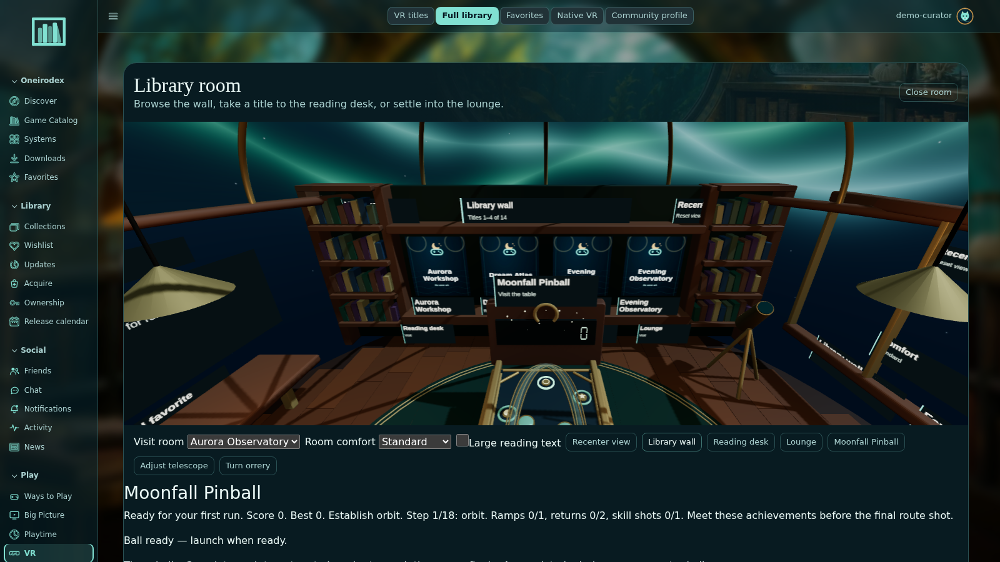

# Library room games

> **Doc status:** Reference
> Development benchmark; not part of the published 1.3.3 release. Disposable browser and database qualification passed, with actual captures inspected. Hardware measurements and human benchmark acceptance remain pending. See the [source-bound evidence](../dev/parity-evidence/aurora-moonfall-benchmark-2026-11-22.md).
> The owner rejected the initial visual finish. The captures below are the earlier prototype; a richer 3D art revision is in progress and requires new in-engine capture and review.

The first redesigned room is **Aurora Observatory**, with the original **Moonfall Pinball** table. The other seven room designs and games are approved concepts; their current rooms retain their existing furnishings and do not offer those new games yet.

Open the library room from the VR Library. **Visit room → Aurora Observatory** visits it without changing your account theme. **Follow my theme** returns to your account's room. Visits last only while the room is open. The normal catalog remains available below the room.

On desktop, **Library wall** provides a raised catalog overview that clears the table's backboard. **Moonfall Pinball** switches to the playfield view. The in-world game menu appears at the table station; the HTML game controls remain available below the room.

Actual disposable-CI capture at source `89988495`, using an original synthetic catalog. [Table view](../media/library-room-benchmark-2026-11-22/moonfall-paused.png) · [Result reached through normal launches](../media/library-room-benchmark-2026-11-22/moonfall-played-result.png). These images show the current benchmark, not an accepted final design.

## Moonfall Pinball

Choose **New run**, or explicitly **Resume saved run**. Nothing starts automatically. Launch the ball, use the flippers and hit the named targets in the displayed order. The three authored routes have 18, 36 and 45 target steps. Each also needs the displayed ramp, return-lane and skill-shot achievements before its closing shot. You start with three balls and two stuck-ball recoveries. One extra ball can be awarded during a run.

**Guided practice** starts a separate disposable run. It explains the launch, flippers, moving targets and raised crescent ramps as you play. **Finish practice** returns to the saved-run choice; practice never changes your server save or personal best. The ring means Orbit, the crescent Moon, and the star Aurora. Hold the left flipper while launching to aim toward Orbit, right toward Aurora, or both toward Moon. A target hit shortly after launch earns a skill shot. A rising shot into a crescent ramp follows its raised path and returns to the opposite flipper; side return lanes feed falling balls back toward the flippers.

| Input | Flippers | Launch | Pause | Recover |
|---|---|---|---|---|
| Keyboard, with room focused | Z / Left Arrow; X / Right Arrow | Space | Escape | R |
| Mouse | Left / right buttons over table | Launch button | Pause button | Recover button |
| Touch or accessible HTML controls | Hold Left / Right flipper | Launch ball | Pause | Recover stuck ball |
| Standard gamepad | Shoulder buttons / triggers | A | Start | Right stick button |
| WebXR controllers | Left / right triggers | A / X | B / Y | In-world / HTML controls |

Leaving focus or moving to another station pauses play. Resume explicitly. Close the room when finished to release its graphics resources. Quality, reduced motion, target contrast, mute and volume are under **How to play and comfort**, with matching **Comfort and sound** in-world menus. **Recover ball** is also available in-world during play. Sound begins muted and requires an explicit gesture to enable it. The observatory's **Adjust telescope** and **Turn orrery** controls provide optional instrument interactions, including with reduced motion enabled.

## Progress and privacy

Runs, settings and personal bests belong to your signed-in account. They are saved on the household server, not in browser storage. Scores are personal and client generated; they are not competitive or server verified.

The game saves at checkpoints and periodically, with one write in flight. **Save progress** saves explicitly. Closing the room or navigating away first attempts to save the latest paused state. If that fails, choose whether to remain or discard unsaved changes. Closing the browser may show its own unsaved-work warning.

- **Connection failure:** the current run stays in memory; **Continue without saving** resumes after a pause. If the initial save could not be loaded, **Play without saving** never overwrites an unknown server revision.
- **Changed elsewhere:** retry reads the server save without replacing your local run. Choose **Load server run** or explicitly **Replace server run**.
- **Access denied:** gameplay stops and private in-memory progress is cleared. Reauthenticate and reopen the room.
- **New run:** replacing a saved/current run requires confirmation; the personal best and settings carry over.
- **Reset progress:** requires confirmation and erases the run, settings and personal best. A payload-free revision record remains to prevent stale sessions from restoring the erased save. Account deletion removes that record too.

Actual desktop rendering, controller usability, frame rates and headset comfort still require the benchmark qualification. The 15–30 minute session target needs human pacing review; deterministic controller replays establish reachability, not that duration or enjoyment. A successful simulation or build does not establish those results.
